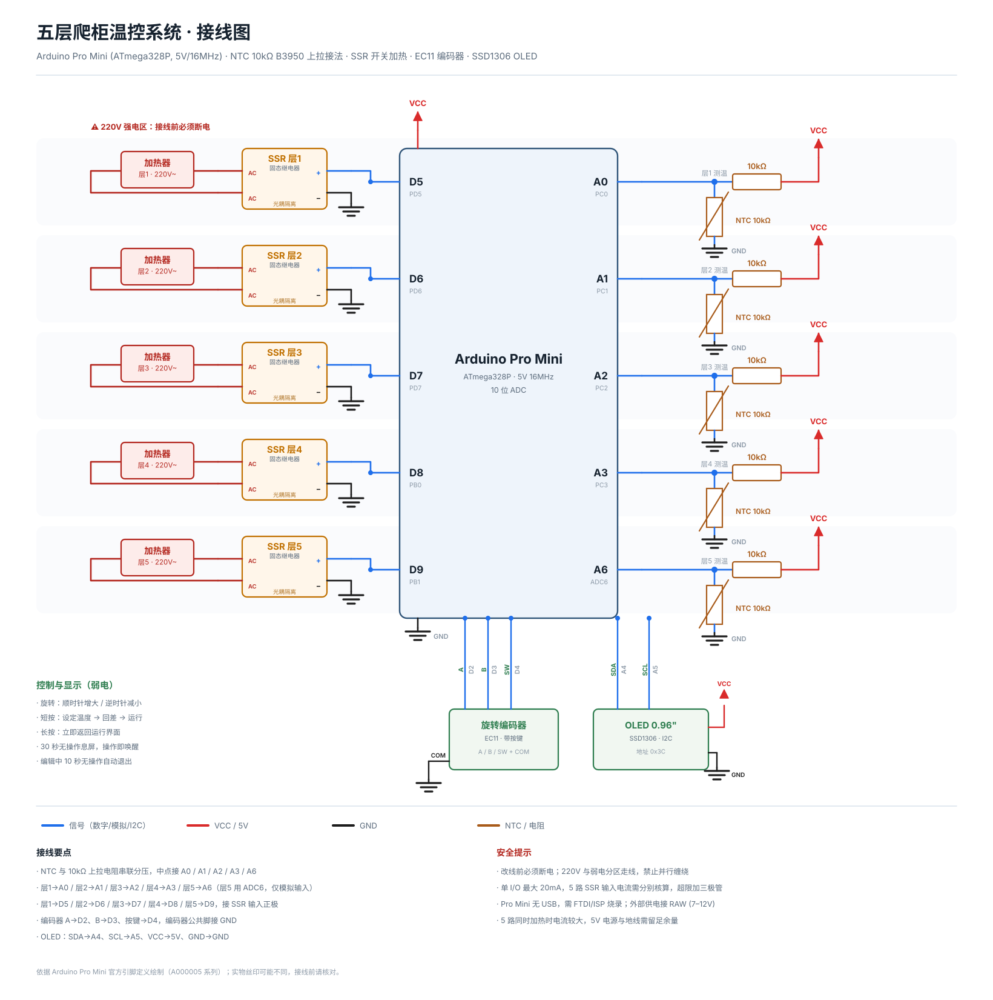
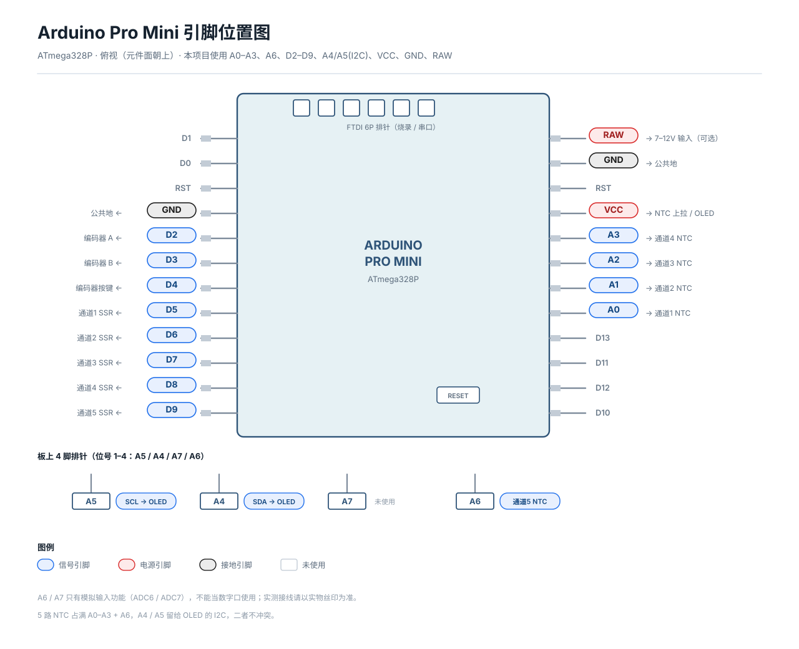

# temp_control

三层爬柜温控系统：NTC 热敏电阻测温 + SSR 开关加热，适用于 Arduino（10 位 ADC）。

## 目录结构

```
temp_control/                       仓库根目录
├── README.md
├── .gitignore
├── docs/
│   └── wiring/
│       ├── wiring-diagram.svg      三层温控接线图
│       ├── pro-mini-pin-map.svg    Pro Mini 引脚位置图
│       └── generate.py             接线图生成脚本
└── firmware/
    └── temp_control/               Arduino sketch 目录
        └── temp_control.ino        主程序
```

Arduino 要求 sketch 目录名与 `.ino` 文件名一致，因此必须打开 `firmware/temp_control/`，而不是仓库根目录。

编译目标为 **Arduino Pro Mini**。`arduino:avr:pro` 需通过菜单选项选择 5V / 16MHz 版本：

```bash
FQBN="arduino:avr:pro:cpu=16MHzatmega328"

# 编译
arduino-cli compile --fqbn "$FQBN" firmware/temp_control

# 上传（Pro Mini 无 USB，需 USB-TTL 转接板；COM 口按实际修改）
arduino-cli upload --fqbn "$FQBN" -p COM3 firmware/temp_control
```

也可以在 Arduino IDE 中选择「Arduino Pro or Pro Mini」→「ATmega328P (5V, 16 MHz)」。
3.3V/8MHz 版本需把菜单改为 `8MHzatmega328`。

Arduino IDE 2.x 用「文件 → 打开」选择 `firmware/temp_control/temp_control.ino` 即可。

## 接线

控制器为 **Arduino Pro Mini（ATmega328P，5V/16MHz）**，NTC 采用上拉接法：
`VCC → 10kΩ → ADC 引脚 → NTC → GND`。

| 层   | NTC 模拟输入 | SSR 控制 | 目标温度 |
| ---- | ------------ | -------- | -------- |
| 层 1 | A2           | D2       | 32 ℃     |
| 层 2 | A1           | D3       | 32 ℃     |
| 层 3 | A0           | D4       | 32 ℃     |

SSR 高电平导通，上电时所有 SSR 引脚先置低，避免误加热。

### 接线图





两张图由 `docs/wiring/generate.py` 生成，修改参数后重新运行即可：

```bash
python3 docs/wiring/generate.py
```

### 接线要点

- NTC 与 10kΩ 上拉电阻串联分压，中点接 `A0` / `A1` / `A2`；NTC 另一端接 GND。
- SSR 输入正极接 `D2` / `D3` / `D4`，输入负极接 GND。
- SSR 输出侧串在 220V 加热器回路中，强电与弱电分区走线。
- Pro Mini 无 USB 口，需用 FTDI 或 ISP 烧录；外部供电接 `RAW`（7–12V）。
- 单 I/O 最大 20mA，若 SSR 输入电流超限需加三极管/MOS 管驱动。

> 注意：`temp_control.ino` 中引脚数组为 `{A2, A1, A0}`，与文件头注释「层1→A0 … 层3→A2」相反。
> 上面的表格与接线图均以代码数组为准，实际接线前请再核对一次。

## 关键参数

均在 `temp_control.ino` 顶部宏定义中调整：

| 参数               | 值           | 说明                  |
| ------------------ | ------------ | --------------------- |
| `R_REF`            | 10 kΩ        | 上拉电阻              |
| `R_NTC` / `T25`    | 10 kΩ / 25 ℃ | NTC 标称值            |
| `B_VALUE`          | 3950         | NTC B 值              |
| `TEMP_HYSTERESIS`  | 0.8 ℃        | 回差带                |
| `TEMP_MAX_LIMIT`   | 45 ℃         | 超温保护上限          |
| `TEMP_MIN_LIMIT`   | 0 ℃          | 低温保护下限          |
| `FILTER_SAMPLES`   | 8            | 滑动平均窗口          |
| `ADC_SAMPLES`      | 5            | 单次测温 ADC 采样次数 |

各层目标温度见 `targetTemp[LAYER_COUNT]`，默认 `{32.0, 32.0, 32.0}`。

## 保护机制

- ADC 多次采样取平均，抑制随机干扰
- NTC 断线 / 短路 / 阻值异常 / 非有限数统一返回 `NAN`，并强制关闭对应层加热
- 8 点滑动平均滤波，异常读数不写入缓冲区
- 回差控制，避免 SSR 在目标温度附近频繁通断
- 超出 0–45 ℃ 范围立即关断加热

## 串口

波特率 `9600`，每秒打印一次三层温度、目标值与加热状态。
