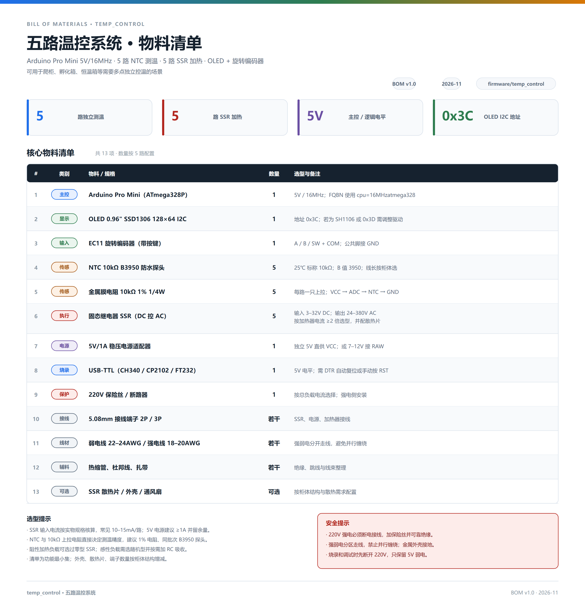

# temp_control

五路温控系统：5 路 NTC 热敏电阻测温 + 5 路 SSR 开关加热 + 旋转编码器设定 + OLED 显示。
可用于爬柜、孵化箱、恒温箱等需要多点独立控温的场景。

## 功能

- 5 路 NTC 独立测温，带回差开关控制与软件超温 / 低温保护
- 旋转编码器在线调节「设定温度」与「回差」，短按切换、长按返回
- 0.96" OLED 实时显示各通道温度与加热状态
- 无操作 30 秒自动息屏，操作即唤醒；编辑中 10 秒无操作自动退出
- 设定值与回差保存在 EEPROM，掉电不丢失
- 串口每秒输出一行状态，便于联调

## 文档

| 文档 | 内容 |
| ---- | ---- |
| [物料清单](docs/bom/README.md) | 完整 BOM、选型建议与清单截图 |
| [烧录指南](docs/flashing/README.md) | USB-TTL 接线、Arduino IDE / arduino-cli、常见烧录错误 |
| [调试指南](docs/debugging/README.md) | 上电顺序、NTC 校验表、串口日志、故障排查 |
| [OLED 操作说明](docs/oled/README.md) | 界面说明、状态机与各状态截图 |

## 目录结构

```text
temp_control/                       仓库根目录
├── README.md
├── .gitignore
├── docs/
│   ├── bom/
│   │   ├── README.md               物料清单说明
│   │   ├── bom-list.svg            BOM 矢量图
│   │   ├── bom-list.png            BOM 截图
│   │   └── generate.py             BOM 生成脚本
│   ├── flashing/
│   │   └── README.md               烧录指南
│   ├── debugging/
│   │   └── README.md               调试指南
│   ├── wiring/
│   │   ├── wiring-diagram.svg      五路温控接线图
│   │   ├── pro-mini-pin-map.svg    Pro Mini 引脚位置图
│   │   └── generate.py             接线图生成脚本
│   └── oled/
│       ├── README.md               OLED 操作说明
│       ├── screen-*.png            各状态界面截图
│       └── render.py               界面图生成脚本
└── firmware/
    └── temp_control/               Arduino sketch 目录
        └── temp_control.ino        主程序
```

Arduino 要求 sketch 目录名与 `.ino` 文件名一致，因此必须打开
`firmware/temp_control/`，而不是仓库根目录。

编译目标为 **Arduino Pro Mini（5V / 16MHz）**，依赖库 `U8g2`。

## 物料清单



清单按 **5 路 NTC + 5 路 SSR** 配置，包含主控、OLED、编码器、探头、上拉电阻、
SSR、5V 电源、USB-TTL、保险丝和接线辅料。完整规格、选型计算和安全件说明见
[docs/bom/README.md](docs/bom/README.md)。

核心配置：

| 类别 | 物料 | 数量 |
| ---- | ---- | ---: |
| 主控 | Arduino Pro Mini（ATmega328P，5V/16MHz） | 1 |
| 显示 | OLED 0.96" SSD1306 128×64 I2C（0x3C） | 1 |
| 输入 | EC11 旋转编码器（带按键） | 1 |
| 传感 | NTC 10kΩ B3950 防水探头 + 10kΩ 1% 上拉电阻 | 5 + 5 |
| 执行 | SSR（DC 3–32V 输入，AC 输出） | 5 |
| 电源 / 烧录 | 5V/1A 电源、5V USB-TTL | 各 1 |

## 烧录

Pro Mini 没有 USB 接口，需要 **5V USB-TTL** 通过 FTDI 6P 排针烧录。
烧录时先断开 220V，只给主板接 5V。

使用 Arduino IDE 2.x：安装 **Arduino AVR Boards** 和 **U8g2 by oliver**，
开发板选择 **Arduino Pro or Pro Mini → ATmega328P (5V, 16 MHz)**，选择 COM 口后上传。

使用 `arduino-cli`：

```bash
arduino-cli core install arduino:avr
arduino-cli lib install U8g2
arduino-cli compile --fqbn arduino:avr:pro:cpu=16MHzatmega328 -u -p COM3 firmware/temp_control
```

把 `COM3` 换成实际端口。完整的 USB-TTL 接线、自动/手动复位、
avrdude 直烧和常见错误处理见 [烧录指南](docs/flashing/README.md)。

## 接线

控制器为 **Arduino Pro Mini（ATmega328P，5V/16MHz）**，NTC 采用上拉接法：
`VCC → 10kΩ → ADC 引脚 → NTC → GND`。

| 通道 | NTC 模拟输入 | SSR 控制 | AVR 端口 |
| ---- | ------------ | -------- | -------- |
| 通道 1 | A0 | D5 | PC0 / PD5 |
| 通道 2 | A1 | D6 | PC1 / PD6 |
| 通道 3 | A2 | D7 | PC2 / PD7 |
| 通道 4 | A3 | D8 | PC3 / PB0 |
| 通道 5 | A6 | D9 | ADC6 / PB1 |

其余外设：

| 外设 | 引脚 | 说明 |
| ---- | ---- | ---- |
| 编码器 A 相 | D2 (INT0) | 内部上拉，另一端接 GND |
| 编码器 B 相 | D3 (INT1) | 内部上拉，另一端接 GND |
| 编码器按键 | D4 | 内部上拉，另一脚接 GND |
| OLED SDA | A4 | I2C 数据 |
| OLED SCL | A5 | I2C 时钟 |
| OLED 地址 | 0x3C | SSD1306 128×64 |

SSR 高电平导通，上电时所有 SSR 引脚先置低，避免误加热。
**通道 5 使用 A6（ADC6），该脚只能做模拟输入，不能当数字口使用。**

### 接线图


两张图由 `docs/wiring/generate.py` 生成，零依赖，改完参数重跑即可：

```bash
python3 docs/wiring/generate.py
```

### 接线要点

- NTC 与 10kΩ 上拉电阻串联分压，中点接 `A0 / A1 / A2 / A3 / A6`，NTC 另一端接 GND。
- SSR 输入正极接 `D5`–`D9`，输入负极接 GND。
- 编码器 A/B/SW 接 `D2 / D3 / D4`，公共脚（COM）接 GND。
- OLED：`SDA→A4`、`SCL→A5`、`VCC→5V`、`GND→GND`。
- SSR 输出侧串在 220V 加热器回路中，强电与弱电分区走线。
- Pro Mini 无 USB 口，需用 FTDI 或 ISP 烧录；外部供电可接 `RAW`（7–12V），也可用稳压 5V 直接接 `VCC`，两者不要同时接。
- 单 I/O 最大 20mA，5 路 SSR 输入电流需分别核算，超限加三极管 / MOS 管驱动。

## 操作说明

上电即进入运行界面，显示设定温度、回差与 5 路实测温度。

| 操作 | 效果 |
| ---- | ---- |
| 旋转 | 调节当前编辑项（运行界面下无效） |
| 短按 | 设定温度 → 回差 → 运行，循环切换 |
| 长按 | 立即返回运行界面 |
| 30 秒无操作 | 息屏（控制继续运行） |
| 任意操作 | 唤醒屏幕 |

屏幕第一行用方括号标出正在编辑的项，例如 `[SET 32.0C] HY 0.8C`。

设定值与回差在**退出编辑模式时**立即写入 EEPROM（长按、超时 10 秒或短按循环回运行界面），
一次编辑会话只擦写一次；掉电重启自动恢复。
完整的界面说明、各状态截图与状态机见 [docs/oled/README.md](docs/oled/README.md)。

## 关键参数

均在 `temp_control.ino` 顶部宏定义中调整：

| 参数 | 值 | 说明 |
| ---- | -- | ---- |
| `R_REF` | 10 kΩ | 上拉电阻 |
| `R_NTC` / `T25` | 10 kΩ / 25 ℃ | NTC 标称值 |
| `B_VALUE` | 3950 | NTC B 值 |
| `TARGET_MIN` / `TARGET_MAX` | 10 / 40 ℃ | 设定温度可调范围 |
| `HYST_MIN` / `HYST_MAX` | 0.2 / 5 ℃ | 回差可调范围 |
| `DEFAULT_TARGET` | 32.0 ℃ | 上电默认设定温度 |
| `DEFAULT_HYST` | 0.8 ℃ | 上电默认回差 |
| `TEMP_MAX_LIMIT` | 45 ℃ | 超温保护上限 |
| `TEMP_MIN_LIMIT` | -20 ℃ | 低温保护下限 |
| `FILTER_SAMPLES` | 8 | 滑动平均窗口 |
| `ADC_SAMPLES` | 5 | 单次测温 ADC 采样次数 |
| `CONTROL_INTERVAL_MS` | 1000 | 测温/控制周期 |
| `SCREEN_SLEEP_MS` | 30000 | 息屏时间 |
| `EDIT_TIMEOUT_MS` | 10000 | 编辑超时退出 |
| `CFG_ADDR` | 0 | 设定值在 EEPROM 中的起始地址 |

## 保护机制

- ADC 多次采样取平均，抑制随机干扰
- NTC 断线 / 短路 / 阻值异常 / 非有限数统一返回 `NAN`，并强制关闭对应通道加热
- 8 点滑动平均滤波，异常读数不写入缓冲区
- 首次有效读数填满缓冲区，避免启动瞬间均值偏低导致误加热
- 回差控制，避免 SSR 在目标温度附近频繁通断
- 超出 -20–45 ℃ 范围立即关断加热（低温下限须低于环境温度，否则会误判故障）
- 出现新故障时自动唤醒屏幕提示
- 设定值与回差保存在 EEPROM，掉电不丢失；校验失败时回退默认值

> 这些是软件保护，不能替代独立硬件保护。长期无人值守时，建议外加机械温控器、
> 热熔断器或独立超温保护器，并确保 220V 侧有保险丝、接地和可靠绝缘。

## 串口

波特率 `9600`，每秒输出一行：

```text
SET 32.0 HY 0.8 HEAT 2 | L1 31.4 H | L2 30.9 H | L3 32.1 - | L4 ERR | L5 31.8 -
```

`H` 表示该路正在加热，`-` 表示关闭，`ERR` 表示读数无效且已强制关断。
字段含义和日志排查见 [调试指南](docs/debugging/README.md)。

## 快速排查

- 五路全部 `ERR`：优先查 5V、GND 共地和 NTC 公共地。
- 单路 `ERR`：查该路 NTC、上拉电阻和 ADC 引脚；通道 5 重点查 A6。
- 该加热不加热：先确认温度低于 `SET - HY`，再查 SSR 输入极性和 D5–D9 电压。
- 一直加热：立即断开 220V，查 SSR 是否击穿或输出侧短路。
- OLED 黑屏：先操作唤醒，再查 5V、A4/A5、地址 0x3C。
- 设定值不保存：确认已长按/超时退出编辑模式。

完整步骤见 [调试指南](docs/debugging/README.md)。
