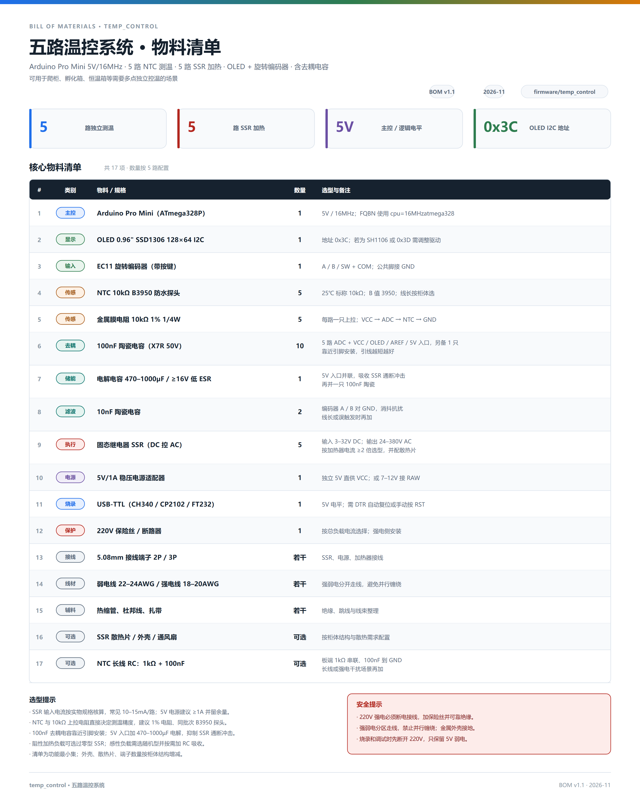

# 物料清单

五路温控系统（可用于爬柜、孵化箱、恒温箱等多点独立控温场景）的完整物料清单。
清单按 **5 路 NTC + 5 路 SSR** 配置，实际采购数量可按通道数增减。



> 截图由 `generate.py` 生成的 `bom-list.svg` 导出，便于直接查看和打印；
> 矢量源文件见 [bom-list.svg](bom-list.svg)。

## 核心清单

| 序号 | 类别 | 物料 / 规格 | 数量 | 选型与备注 |
| ---: | ---- | ----------- | ---: | ---------- |
| 1 | 主控 | Arduino Pro Mini（ATmega328P） | 1 | **5V / 16MHz**；烧录 FQBN 使用 `cpu=16MHzatmega328` |
| 2 | 显示 | OLED 0.96" SSD1306 128×64 I2C | 1 | 地址 `0x3C`；若为 SH1106 或 `0x3D`，需改驱动/地址 |
| 3 | 输入 | EC11 旋转编码器（带按键） | 1 | A / B / SW + COM；公共脚接 GND |
| 4 | 传感 | NTC 10kΩ B3950 防水探头 | 5 | 25℃ 标称 10kΩ，B 值 3950；线长按柜体尺寸选择 |
| 5 | 传感 | 金属膜电阻 10kΩ 1% 1/4W | 5 | 每路一只上拉电阻：`VCC → 10kΩ → ADC → NTC → GND` |
| 6 | 去耦 | 陶瓷电容 100nF（X7R 50V） | 10 | 5 路 ADC 各 1 + VCC / OLED / AREF / 5V 入口各 1，另备 1 只 |
| 7 | 储能 | 电解电容 470–1000µF / ≥16V 低 ESR | 1 | 并在 5V 入口，吸收 SSR 通断冲击；再并一只 100nF |
| 8 | 滤波 | 陶瓷电容 10nF | 2 | 编码器 A / B 对 GND，消抖抗扰 |
| 9 | 执行 | 固态继电器 SSR（DC 控 AC） | 5 | 输入 3–32V DC；输出 24–380V AC；按加热器电流 ≥2 倍选型 |
| 10 | 电源 | 5V/1A 稳压电源适配器 | 1 | 独立 5V 直供 `VCC`；或用 7–12V 接 `RAW` |
| 11 | 烧录 | USB-TTL（CH340 / CP2102 / FT232） | 1 | **5V 电平**；支持 DTR 自动复位，或手动按 RST |
| 12 | 保护 | 220V 保险丝 / 断路器 | 1 | 按总负载电流选择，安装在强电侧 |
| 13 | 接线 | 5.08mm 接线端子 2P / 3P | 若干 | SSR、电源、加热器接线 |
| 14 | 线材 | 弱电 22–24AWG / 强电 18–20AWG | 若干 | 强弱电分开走线，避免并行缠绕 |
| 15 | 辅料 | 热缩管、杜邦线、扎带 | 若干 | 绝缘、跳线与线束整理 |
| 16 | 可选 | SSR 散热片 / 外壳 / 通风扇 | 可选 | 按柜体结构和散热需求配置 |
| 17 | 可选 | 1kΩ 电阻 + 100nF 电容 | 可选 | NTC 长线时做板端 RC 滤波 |

## 关键选型

### 5V 电源

- Pro Mini、OLED、编码器和 5 路 SSR 输入都由 5V 供电时，总电流通常在 **100–200mA** 以内。
- 建议选 **5V/1A** 稳压电源，给 SSR 输入和后续扩展留余量。
- 5V 只能接 Pro Mini 的 `VCC`，不要接 `RAW`；`RAW` 需要 7–12V，板载稳压器才有足够压差。
- 若使用 USB-TTL 的 VCC 给板子供电，**不要再同时接 RAW 电源**，避免两路电源互相顶牛。
- 5 路 SSR 同时导通时，注意电源和地线压降；出现复位/屏幕闪烁时，优先加大电源并加 470–1000µF 电解电容。

### 电容与去耦

按收益排序，建议按下面的清单一次配齐（都便宜，能省掉大量玄学排查）：

| 位置 | 规格 | 数量 | 作用 |
| ---- | ---- | ---: | ---- |
| 5V 入口 / SSR 汇流处 | 电解 470–1000µF / ≥16V 低 ESR + 100nF 陶瓷 | 1 组 | 吸收 5 路 SSR 同时通断的电流冲击，防复位、花屏、串口掉线 |
| 每路 ADC（A0–A3、A6）→ GND | 100nF 陶瓷 | 5 | 与 10kΩ 上拉组成约 300Hz 低通，τ≈0.5ms，不影响 1Hz 采样 |
| Pro Mini `VCC` → GND | 100nF 陶瓷 | 1 | 主控去耦 |
| OLED `VCC` → GND | 100nF 陶瓷（可再并 10µF） | 1 | 压住整屏刷新时的瞬时跌落 |
| `AREF` → GND | 100nF 陶瓷 | 1 | 稳定 ADC 基准 |
| 编码器 A / B → GND | 10nF 陶瓷 | 2 | 消抖抗扰；不要盲目上 100nF，否则快转会丢步 |
| NTC 长线（可选） | 板端 1kΩ 串联 + 100nF 到 GND，探头端再并 100nF | 5 | 两级 RC，抑制强电与射频耦合 |

接线示意（每路一份）：

```text
VCC ── 10kΩ ──┬── ADC
              ├── 100nF ── GND
             NTC
              │
             GND
```

注意：ADC 节点不要并大电解或 1µF 以上的电容，漏电大、响应慢，100nF 足够。
NTC 分压与 ADC 基准同源于 VCC，属于比率测量，VCC 小幅波动会互相抵消，
不需要额外加精密基准。

### SSR 容量

按加热器铭牌功率估算：

```text
加热器电流 I = 功率 P / 电压 U
例如 500W / 220V ≈ 2.3A
```

- SSR 额定电流建议取 **工作电流的 2 倍以上**，并按厂家要求安装散热片。
- 阻性加热器可选 **过零型（Zero-cross）** SSR；感性负载需选随机型并按需加 RC 吸收。
- SSR 输入必须选 **DC 3–32V** 类型，才能由 5V GPIO 驱动；不要买 12V 专用输入或 AC 输入型。
- 单路 GPIO 建议不超过 20mA；5 路 SSR 输入电流较大时，用三极管 / MOS 管缓冲，避免长时间满负荷。

### NTC 与上拉电阻

- NTC：**10kΩ @ 25℃、B=3950**，防水探头优先，便于放入柜内或水箱。
- 上拉电阻：**10kΩ 1% 金属膜**，每路一只；精度直接影响测温误差。
- 探头线尽量避开 220V 强电和 SSR 输出线；长线用双绞线或屏蔽线。
- 探头线较长或现场干扰大时，在板端加 1kΩ 串联 + 100nF 到 GND 做 RC 滤波。
- 不要把 NTC 接到 A6 以外的“数字口”当模拟口用；通道 5 固定使用 **A6（ADC6）**。

### USB-TTL

- 必须使用 **5V 电平**的 USB-TTL；3.3V 电平模块可能无法可靠烧录 5V Pro Mini。
- 常见芯片：CH340、CP2102、FT232。Windows 需安装对应驱动。
- 优先选带 **DTR** 引脚的模块，可配合 0.1µF 电容实现自动复位；没有 DTR 时手动按 RST。

## 安全件

- 220V 侧必须加保险丝或断路器，并按负载电流选择。
- 强电接头使用接线端子、热缩管和绝缘外壳，不能裸露。
- 金属外壳可靠接地；强弱电分区走线，禁止并行缠绕。
- 调试、烧录、改线时先断开 220V，只保留 5V 弱电。

## 重新生成

```bash
python3 docs/bom/generate.py
```

生成 `docs/bom/bom-list.svg`。如需 PNG 截图，可用 Chrome / Edge 无头模式：

```bash
chrome --headless=new --disable-gpu --hide-scrollbars --force-device-scale-factor=2 --window-size=1400,1746 --screenshot=docs/bom/bom-list.png file:///绝对路径/temp_control/docs/bom/bom-list.svg
```

仓库中的 `bom-list.png` 即由上述方式导出（2 倍像素密度）。
