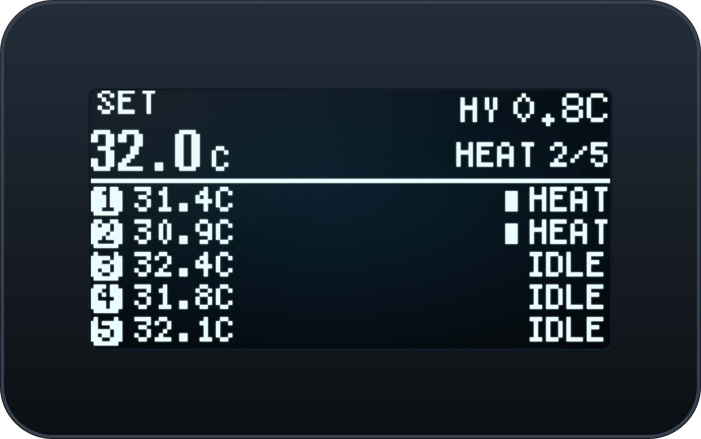
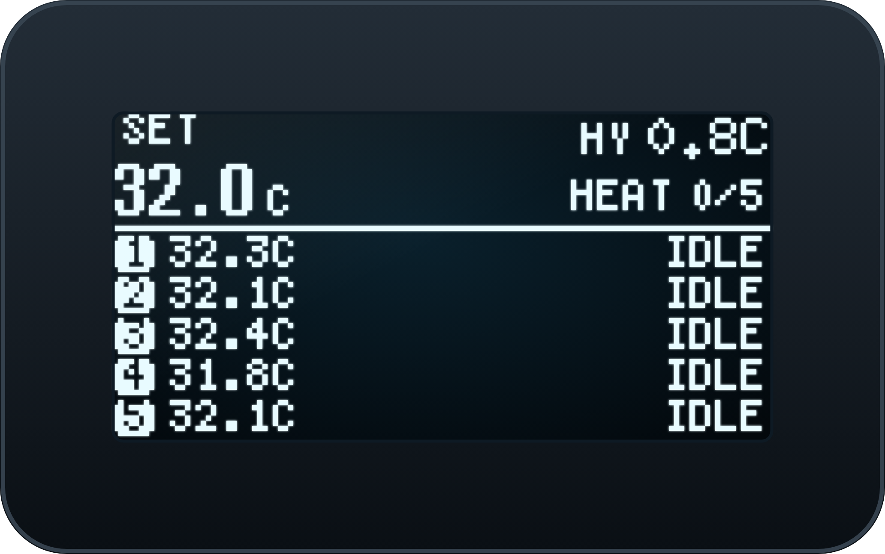
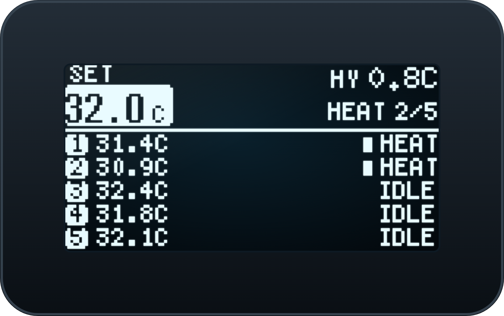
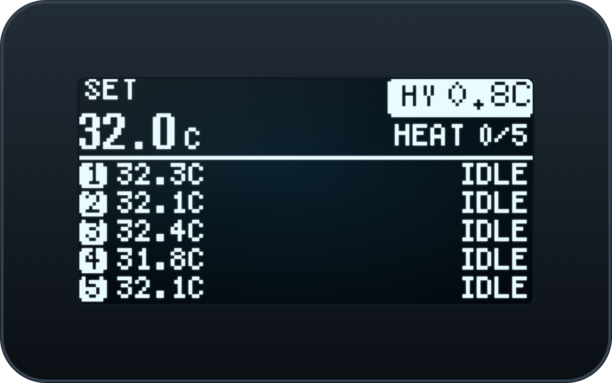
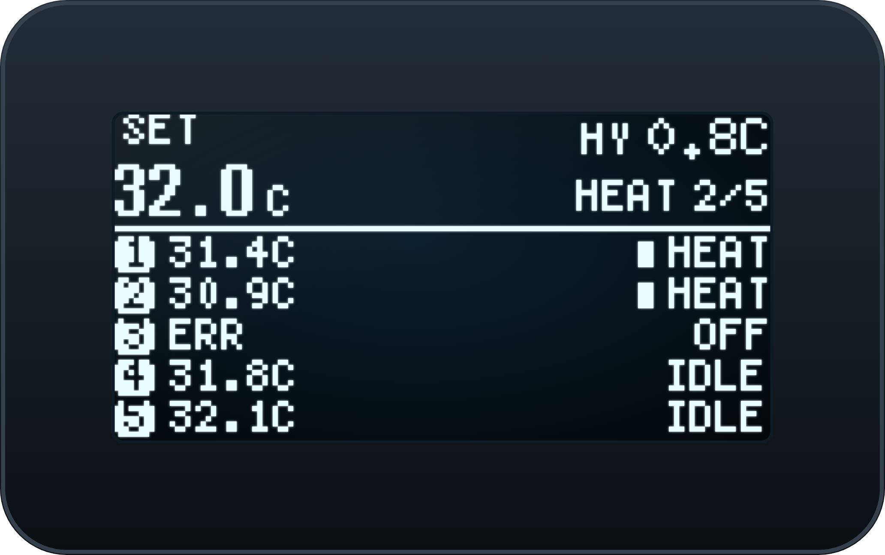

# OLED 操作说明

0.96" SSD1306（128×64，I2C 地址 `0x3C`）的完整界面说明。
下面所有截图都由 `docs/oled/sim.cpp` 调用固件同一份 `ui.h` 绘制，
使用真实 U8g2 字体点阵生成，与实机显示一致。

## 界面布局

```text
┌────────────────────────────────┐
│ SET                    HY  0.8C │
│ 32.0C                HEAT  2/5 │
│ ────────────────────────────── │
│ [1] 31.4C              ■ HEAT  │
│ [2] 30.9C              ■ HEAT  │
│ [3] 32.4C                 IDLE  │
│ [4] 31.8C                 IDLE  │
│ [5] 32.1C                 IDLE  │
└────────────────────────────────┘
```

- 顶部左侧是 `SET` 标签和大号设定温度，单位 `C` 紧跟在数值后面。
- 顶部右侧第一行是回差 `HY`，第二行是当前加热路数 `HEAT n/5`。
- 中间的横线把全局设定和各通道状态分开。
- 通道号显示为反色小徽标；`■ HEAT` 表示 SSR 正在导通，`IDLE` 表示未加热。
- 故障通道显示 `ERR` 和右对齐的 `OFF`，不会显示虚假温度。

### 字段含义

| 位置 | 内容 | 说明 |
| ---- | ---- | ---- |
| 左上 | `SET` / `32.0C` | 设定温度（目标值），可调 10.0–40.0 ℃ |
| 右上第一行 | `HY 0.8C` | 回差（迟滞带），可调 0.2–5.0 ℃ |
| 右上第二行 | `HEAT 2/5` | 当前 5 路中有 2 路正在加热 |
| 每行左侧 | `[1]`–`[5]` | 通道号反色徽标 |
| 每行中间 | `31.4C` | 该通道滤波后的实测温度，保留 1 位小数 |
| 每行右侧 | `■ HEAT` | 该通道 SSR 正在导通 |
| 每行右侧 | `IDLE` | 该通道未加热（已达温或待机） |
| 每行右侧 | `ERR` / `OFF` | 传感器异常，加热已被强制关闭 |

> 设定温度范围是 10.0–40.0 ℃，所以 `SET` 不会显示负值。
> 通道温度在软件保护范围内可以显示负值，单位位置会按数字宽度自动调整。

## 界面状态

### 1. 运行界面 · 加热中



通道 1、2 温度低于 `SET - HY`，SSR 导通，右侧显示 `■ HEAT`。
通道 3–5 已进入回差带内，显示 `IDLE`。

### 2. 运行界面 · 恒温待机



5 个通道都在目标区间内，全部显示 `IDLE`，此时不加热。
温度降到 `SET - HY` 以下会自动恢复 `HEAT`，升到 `SET + HY` 以上才停；
回差带用于避免 SSR 在目标点反复通断。

### 3. 编辑设定温度



短按一次进入编辑，大号设定值区域反色高亮。
顺时针旋转 +0.1 ℃/档，逆时针旋转 -0.1 ℃/档，范围 10.0–40.0 ℃。

### 4. 编辑回差



再短按一次切到回差，右上角 `HY` 所在区域反色高亮。
范围 0.2–5.0 ℃，步进 0.1 ℃。回差越大，SSR 通断越少、温度波动越大。

### 5. 传感器故障



该通道 NTC 断线、短路或读数越界时，显示 `ERR` 和 `OFF`，
该路加热被强制关闭。**出现新故障时会自动点亮屏幕**，即使刚才已经息屏。

### 6. 自动息屏


30 秒无任何操作后 `oled.setPowerSave(1)` 关闭显示，屏幕全黑。
**温控照常运行**；旋转编码器或按一下按键会立即唤醒并重绘界面。

## 操作方式

| 动作 | 效果 |
| ---- | ---- |
| 旋转 | 调节当前高亮项（运行界面下无效） |
| 短按 | 设定温度 → 回差 → 运行，循环切换 |
| 长按 ≥0.8 s | 立刻返回运行界面 |
| 30 s 无操作 | 息屏 |
| 编辑中 10 s 无操作 | 自动返回运行界面 |
| 任意旋转 / 按键 | 唤醒屏幕 |

退出编辑模式时（长按、超时或短按循环回运行界面）会立即保存设定值和回差到 EEPROM。
一次编辑会话只擦写一次，避免频繁写 EEPROM。

## 状态机

```text
            短按                短按
  RUN ──────────────► SET_TEMP ──────────────► SET_HYST
   ▲                     │                        │
   │      长按 / 10s 无操作 │      长按 / 10s 无操作  │
   └─────────────────────┴────────────────────────┘
```

息屏是独立的显示状态，不影响上面的界面模式，也不影响温控循环。

## 界面实现细节

- 绘制入口是 `firmware/temp_control/ui.h` 的 `uiDrawFrame()`，
  固件和离线截图共用同一份代码，避免文档与实际界面不一致。
- 顶部设定值使用 `u8g2_font_7x14B_tn`（只包含数字和常用符号，节省 flash），
  `HY` 使用 `u8g2_font_6x10_tf`，标签、通道号和状态文字使用 `u8g2_font_5x7_tf`。
- 通道号使用圆角反色块，状态文字统一右对齐；`HEAT` 前绘制一个实心小方块作为加热指示。
- 每帧先把待显示内容压缩成 `DisplaySnapshot`（界面模式、设定值/回差、各通道 0.1℃ 量化值、
  有效/加热标志），与上次绘制完全一致时跳过整屏刷新。
- 因此温度在 0.1℃ 内波动、或稳态恒温时屏幕不发数据；只有显示内容真正变化才刷新一次。
- 使用页缓冲模式 `U8G2_SSD1306_128X64_NONAME_1_HW_I2C`，只占 128 B RAM。
- 唤醒后强制重绘一次，确保恢复供电后的画面与实际状态一致。

## 重新生成截图

```bash
# 只生成 SVG
python3 docs/oled/render.py

# 同时生成 PNG（需要本机有 Chrome 或 Edge）
python3 docs/oled/render.py --png
```

脚本会：

1. 用 `g++` 编译 `docs/oled/sim.cpp`；
2. 运行仿真，得到真实 U8g2 字体渲染的 128×64 PBM 位图；
3. 将位图转换成带 OLED 外壳的 SVG；
4. 可选调用浏览器导出 PNG。

仿真构建和 PBM 文件放在系统临时目录，不会污染仓库。

依赖：

- `g++`
- U8g2 库源码，默认 `~/Arduino/libraries/U8g2/src`
- 如库不在默认位置，可指定：

```bash
U8G2_SRC=/path/to/U8g2/src python3 docs/oled/render.py --png
```

截图文件：

| 文件 | 状态 |
| ---- | ---- |
| `screen-run-heat.png` | 运行界面，部分通道加热 |
| `screen-run-idle.png` | 运行界面，全部待机 |
| `screen-edit-temp.png` | 编辑设定温度 |
| `screen-edit-hyst.png` | 编辑回差 |
| `screen-fault.png` | 传感器故障 |
| `screen-sleep.png` | 自动息屏 |
