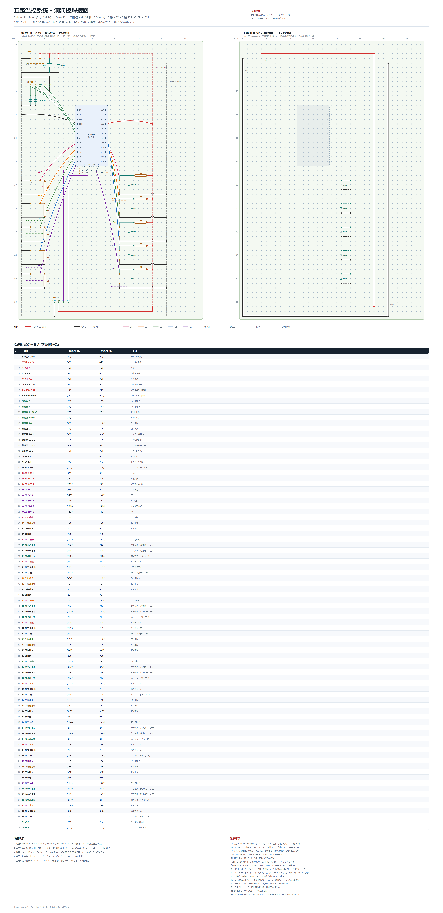

# 洞洞板焊接图

推荐板型：**10cm × 15cm 洞洞板**，39 列 × 59 行，孔距 2.54mm，可用区域约 96.5 × 147mm。
孔位统一写作 `(列, 行)`：列 0–38 自左向右，行 0–58 自上而下，均为元件面俯视。

- [SVG 矢量版](perfboard-layout.svg)：可放大查看焊盘和坐标
- [生成脚本](perfboard.py)：`py -3 docs/wiring/perfboard.py`

## 两页图怎么读

| 页面 | 内容 | 用途 |
| ---- | ---- | ---- |
| ① 元件面 | 模块位置、阻容位置、全部绝缘跳线 | 规划走线、量跳线长度 |
| ② 焊接面 | GND 裸铜母线、+5V 绝缘线、NTC 100nF 与背面短跳 | 翻面后照图焊母线 |

元件面的虚线框表示模块/端子的**本体占位范围**，不是焊盘；实际焊点都在背面。
图上的跳线是绝缘线，可以架空跨越别的焊盘；同一种颜色代表同一通道。

## 关键孔位

| 部分 | 孔位 |
| ---- | ---- |
| Pro Mini 左排 | 列 12，行 14–25（D1…D9） |
| Pro Mini 右排 | 列 18，行 14–25（RAW…D10） |
| Pro Mini 本体 | 列 11.5–18.5，行 13–26（约 18 × 33mm） |
| A4–A7 转接排针 | 1×4P，列 13–16，行 27（A5/A4/A7/A6） |
| SSR 单元 | 5 组，基准行 29 / 34 / 39 / 44 / 49 |
| SSR 端子 | `(2,b)` = GND，`(4,b)` = 信号；10k 下拉 `(5,b)`–`(5,b+3)` |
| NTC 单元 | 与 SSR 同基准行 |
| NTC 端子 | `(21,b)` = 信号，`(21,b+2)` = GND |
| NTC 上拉 | 10k 在行 `b-1`，`(24,b-1)`–`(27,b-1)`，右端接 `(28,b-1)` |
| NTC 滤波 | 100nF 在背面 `(23,b)`–`(23,b+2)`，两根短线接到 `(21,b)`/`(21,b+2)` |
| 编码器 | 5P，列 2–6，行 9：A / B / COM / SW / SW2 |
| 编码器消抖 | 10nF：`(2,11)`–`(2,13)`、`(3,11)`–`(3,13)`，A/B 对地 |
| OLED | 4P，列 7–10，行 55：GND / VCC / SCL / SDA |
| 电源入口 | 2P：`(2,3)` = GND，`(4,3)` = +5V；470µF 在列 6，100nF 在列 8 |

## 母线

- **GND：裸铜线**，路径为列 0（行 3→58）→ 行 58（列 0→31）→ 列 31（行 58→4），逐孔上锡。
- **+5V：绝缘线**，路径为行 2（列 4→28）→ 列 28（行 2→56），只在抽头孔剥皮上锡。

这样 NTC 的地线可以在行 `b+3` 直接从 +5V 绝缘线上方跨过，不会短路；
跨线处不剥皮、不上锡。图中用半圆“跨线”符号标出。

## 推荐焊接顺序

1. **插座**：Pro Mini `2×12P + 1×4P`、EC11 `5P`、OLED `4P`、10 个 `2P` 端子。先焊对角两点定位，再补齐。
2. **背面母线**：先焊 GND 裸铜，再走 +5V 绝缘线；每到一个抽头先剥皮、上锡，再继续。
3. **阻容**：10k 上拉 ×5、10k 下拉 ×5、100nF ×6（NTC 的 5 个在背面）、10nF ×2、470µF ×1。
4. **跳线**：按接线表逐条焊，同色同通道；先量长度再剪，架空 2–3mm，不压模块。
5. **上电检查**：先不插模块，万用表确认 +5V 对 GND 无短路；再插 Pro Mini 看串口 5 路读数。

## 注意事项

- 2P 端子为 5.08mm 间距：SSR 横放（行内 2 孔），NTC 竖放（列内 2 孔）。
- Pro Mini 两排排针间距 15.24mm（6 孔）：左排列 12、右排列 18。
- A4–A7 排与两侧排针错开 1.27mm，不能直接落在同一 2.54mm 网格；用 4 根短线引到板上 1×4P 排针。
- 编码器用 5P：A/B/C/SW/SW2，SW2 接 GND；4P 模块若按键公共端已内部接 C，可悬空第 5 脚。
- 10nF 只用于编码器 A/B 对地，不要用 100nF 代替，否则快速旋转会丢步。
- NTC 的 100nF 是 ADC 节点滤波，焊在端子背面，引线越短越好。
- BOM 中的 100nF ×10：本图画出 5 路 NTC + 5V 入口；Pro Mini VCC、OLED VCC、AREF 各 1 只就近焊在模块背面。
- 强电不上本板：SSR 输出侧与 220V 全部走板外，并保持爬电距离。
- 不同厂家 Pro Mini / 端子的本体尺寸可能不同；下单前用卡尺复核，孔位以实物为准。

## 与逻辑接线图的关系

- [wiring-diagram.svg](wiring-diagram.svg)：电气连接关系（谁接谁）。
- [pro-mini-pin-map.svg](pro-mini-pin-map.svg)：Pro Mini 引脚位置。
- 本页 `perfboard-layout.*`：把上述连接落到具体孔位的物理布局。
